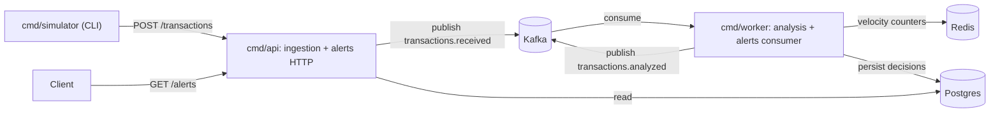

# Architecture

Last reviewed: 2026-11-02. Most of this document is **planned**: today only `cmd/api` with `GET /health` and `internal/config` exist. Update this file when a module boundary, binary, topic or data ownership changes.

## Overview

Simulated card transactions are sent to an ingestion API, published to Kafka, and analyzed asynchronously by a rule engine that scores each transaction and decides `approve`, `review` or `block`. Decisions are stored and exposed for querying.

Style: modular monolith. One Go module, several binaries, modules isolated by package boundaries and communicating through Kafka events.

## Runtime



Binaries (all in `cmd/`, each wires its modules in `main.go`):

| Binary | Runs | Talks to |
|---|---|---|
| `cmd/api` | `ingestion` HTTP handlers, `alerts` query handlers | Kafka (produce), Postgres (read) |
| `cmd/worker` | `analysis` consumer, `alerts` consumer | Kafka (consume/produce), Redis, Postgres |
| `cmd/simulator` | `simulator` event generator | `cmd/api` over HTTP only |

Topic names below are proposed; confirm before creating them.

| Topic | Producer | Consumer | Payload |
|---|---|---|---|
| `transactions.received` | `ingestion` | `analysis` | `events.TransactionReceived` |
| `transactions.analyzed` | `analysis` | `alerts` | `events.TransactionAnalyzed` |

## Codemap

```
cmd/api/               HTTP entrypoint (exists)
cmd/worker/            Kafka consumers entrypoint
cmd/simulator/         CLI that generates simulated transactions
internal/ingestion/    validates incoming transactions, publishes transactions.received
internal/analysis/     consumes transactions.received, runs rules, publishes transactions.analyzed
internal/alerts/       consumes transactions.analyzed, persists decisions, serves queries
internal/simulator/    builds realistic/fraudulent transaction scenarios
internal/events/       shared event contracts (types + topic names), no logic
internal/platform/     shared infrastructure: config, logging, postgres, kafka, redis
```

`internal/config` exists today and moves to `internal/platform/config` when `platform` is created.

Each module is a single package with files per layer:

- `handler.go` (HTTP) or `consumer.go` (Kafka): decode input, validate shape, call the service, map errors to responses.
- `service.go`: business logic. Depends on small interfaces declared in this package.
- `repository.go` / `publisher.go`: Postgres, Redis or Kafka adapters implementing those interfaces.
- `model.go`: domain types of the module.

In `analysis`, each rule lives in its own file `rule_<name>.go` and implements:

```go
type Rule interface {
	Name() string
	Evaluate(ctx context.Context, tx Transaction) (RuleResult, error)
}
```

`RuleResult` carries the rule name, a score and a human-readable reason. The service sums the scores of all rules and maps the total to a decision using thresholds from config. Rule parameters (limits, windows) come from config, never hardcoded.

## Boundaries

1. Modules never import each other. Only `cmd/*` imports modules; modules share data only through `internal/events` contracts sent over Kafka.
2. `internal/events` and `internal/platform` never import modules.
3. Inside a module, dependencies go downward: handler/consumer -> service -> repository/publisher. Services never import `net/http`, Kafka or database client packages; they depend on interfaces.
4. Each module owns its own Postgres schema (e.g. `alerts`). No module reads or writes another module's tables. `ingestion` and `analysis` own no tables initially.
5. `simulator` only knows the public HTTP contract of the ingestion API.

## Invariants

- Kafka delivery is at-least-once. Every consumer MUST be idempotent, keyed by `transaction_id`. Commit offsets only after processing succeeds.
- `transaction_id` is the Kafka message key and the idempotency key. `alerts` upserts by `transaction_id`.
- Velocity counters in Redis must tolerate redelivery: use sorted sets with `transaction_id` as member and the event timestamp as score, so reprocessing does not double count.
- Ingestion responds `202 Accepted` only after the event is published to Kafka; publish failure returns `503`. Analysis results are never returned by the ingestion endpoint.
- Money is `int64` in minor units (cents) plus an ISO 4217 currency code. Never use floats for amounts.
- All timestamps are UTC (`time.Time`, RFC 3339 in JSON).
- Rule evaluation is deterministic for the same input and Redis state; rules have no side effects besides reading Redis.

## Cross-cutting concerns

- Config: env vars only, loaded once in `main.go` through `platform/config` and passed down via constructors.
- Logging: `log/slog` JSON. Include `transaction_id` on every log line related to a transaction.
- Context: every I/O call receives a `context.Context`; the root context is cancelled on SIGINT/SIGTERM.
- Shutdown: `cmd/api` drains HTTP with `Server.Shutdown`; `cmd/worker` stops fetching, finishes in-flight messages and commits offsets before exiting.
- Errors: wrapped with `%w`; handlers and consumers are the only places that translate errors into HTTP status codes or retry/skip decisions.

## Open decisions

- Postgres migrations tool and Kafka/Postgres/Redis client libraries.
- Retry and dead-letter strategy for messages that keep failing.
- Initial rule set and score thresholds.
- Compose services for `cmd/worker` (today only `app`, which runs `cmd/api`).
