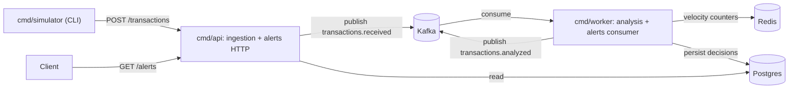

# Architecture

Last reviewed: 2026-11-02. Part of this document is **planned**. Today `cmd/api` (ingestion: `POST /transactions` publishing to `transactions.received`, plus `/health`, `/ready`, `/metrics`), `cmd/simulator`, the modules `ingestion` and `simulator`, `internal/events` and `internal/platform/{config,httpmw,ids,kafka}` exist. `cmd/worker`, `analysis`, `alerts`, Postgres and Redis usage are planned. Update this file when a module boundary, binary, topic or data ownership changes.

## Overview

Simulated card transactions are sent to an ingestion API, published to Kafka, and analyzed asynchronously by a rule engine that scores each transaction and decides `approve`, `review` or `block`. Decisions are stored and exposed for querying.

Style: modular monolith. One Go module, several binaries, modules isolated by package boundaries and communicating through Kafka events.

## Runtime



Binaries (all in `cmd/`, each wires its modules in `main.go`):

| Binary | Runs | Talks to |
|---|---|---|
| `cmd/api` | `ingestion` HTTP handlers, `alerts` query handlers | Kafka (produce), Postgres (read) |
| `cmd/worker` | `analysis` consumer, `alerts` consumer | Kafka (consume/produce), Redis, Postgres |
| `cmd/simulator` | `simulator` event generator | `cmd/api` over HTTP only |

| Topic | Status | Producer | Consumer | Payload |
|---|---|---|---|---|
| `transactions.received` | implemented (created by `cmd/api` at startup) | `ingestion` | `analysis` (planned) | `events.TransactionReceived` |
| `transactions.analyzed` | proposed; confirm before creating | `analysis` | `alerts` | `events.TransactionAnalyzed` |

### Event envelope

Every event is JSON with a versioned envelope ([ADR 0005](docs/decisions/0005-wrap-kafka-events-in-a-versioned-json-envelope.md)). Golden example: `internal/events/testdata/transaction_received.golden.json`.

- Key: `transaction_id`. Headers: `event_type`, `schema_version`, `request_id`.
- Value: `event_id` (new UUID per publish), `event_type`, `schema_version`, `received_at` (UTC), `request_id`, and `transaction` with the HTTP contract fields, `occurred_at` normalized to UTC.
- Duplicates of a `transaction_id` produce distinct events with distinct `event_id`s: dedupe by `transaction.transaction_id`.

## Ingestion HTTP contract

`POST /transactions` is the only contract `simulator` knows. Status: **implemented** by `internal/ingestion`; `internal/simulator` generates traffic against it.

```json
{
  "transaction_id": "7c9e6679-7425-40de-944b-e07fc1f90ae7",
  "account_id": "acc_3f9a1c2b7d4e",
  "card_id": "card_9b2c4d6e8f10",
  "amount": 12990,
  "currency": "BRL",
  "merchant": { "id": "mer_51a2b3c4d5e6", "name": "Grocery 5e6f", "mcc": "5411", "country": "BR" },
  "channel": "card_present",
  "device_id": "dev_0a1b2c3d4e5f",
  "ip": "177.34.10.200",
  "occurred_at": "2026-11-02T19:15:00Z"
}
```

| Field | Rule |
|---|---|
| `transaction_id` | UUID v4, lowercase. Idempotency key. |
| `account_id`, `card_id`, `device_id`, `merchant.id` | `^[A-Za-z0-9_-]{1,64}$` |
| `amount` | integer `> 0`, minor units of the card currency (cardholder billing amount). Floats and strings are rejected. |
| `currency` | ISO 4217, `^[A-Z]{3}$` |
| `merchant.name` | 1-128 printable characters, no control or format characters |
| `merchant.mcc` | `^[0-9]{4}$` |
| `merchant.country` | ISO 3166-1 alpha-2, `^[A-Z]{2}$` |
| `channel` | `card_present`, `ecommerce` or `contactless` |
| `ip` | IPv4 or IPv6 literal |
| `occurred_at` | RFC 3339; at most 5 minutes in the future (clock skew). Old events are accepted (late arrival). |

All fields are required; unknown fields are rejected. Responses:

| Status | When |
|---|---|
| `202 Accepted` | valid payload, published and acknowledged by Kafka, including duplicates of an already accepted `transaction_id` (dedupe happens in consumers). Body `{"transaction_id": "..."}` |
| `400 Bad Request` | invalid JSON, wrong types, missing/unknown fields, trailing data after the object, any rule above violated |
| `413 Content Too Large` | body larger than 64 KiB |
| `415 Unsupported Media Type` | `Content-Type` is not `application/json` (parameters such as `charset` are allowed) |
| `429 Too Many Requests` | global rate limit exceeded (`INGEST_RATE_LIMIT_RPS`, disabled by default), with `Retry-After` |
| `503 Service Unavailable` | Kafka did not acknowledge within `INGEST_PUBLISH_TIMEOUT`, with `Retry-After`; retrying with the same `transaction_id` is safe |

Checks run in this order: rate limit, `Content-Type`, size, JSON decoding, field rules. `429` and `503` depend on load and broker health, never on the payload, so simulator scenarios do not expect them.

Every response carries `X-Request-ID` (a well-formed incoming value is reused, otherwise a UUID v4 is generated). Every error body is `application/problem+json` ([ADR 0006](docs/decisions/0006-problem-details-errors-and-global-rate-limit.md)):

```json
{
  "type": "/problems/validation",
  "title": "Invalid transaction",
  "status": 400,
  "instance": "/transactions",
  "request_id": "82bb82b3-129c-4d9a-b6d0-c3599769873a",
  "errors": [{ "field": "merchant.mcc", "detail": "\"54\" must be a 4-digit MCC" }]
}
```

`type` values: `/problems/validation` (field rules; lists all violations), `/problems/malformed-body` (JSON syntax, types, unknown fields, empty body; `errors` set when a field is known), `/problems/body-too-large`, `/problems/unsupported-media-type`, `/problems/rate-limited`, `/problems/publish-unavailable`, `/problems/internal`.

### Operational endpoints

| Endpoint | Answers |
|---|---|
| `GET /health` | `200 {"status":"ok"}` while the process runs (liveness) |
| `GET /ready` | `200 {"status":"ready"}` if a Kafka broker answers within 2 s, else `503` problem (readiness) |
| `GET /metrics` | Prometheus text format ([ADR 0007](docs/decisions/0007-expose-prometheus-metrics.md)): `http_requests_total`, `http_request_duration_seconds`, `ingestion_publish_duration_seconds`, Go runtime and process metrics |

## Codemap

```
cmd/api/                  HTTP entrypoint; routes and middleware wiring in routes.go (exists)
cmd/worker/               Kafka consumers entrypoint (planned)
cmd/simulator/            CLI that generates simulated transactions (exists)
internal/ingestion/       validates incoming transactions, publishes transactions.received (exists)
internal/analysis/        consumes transactions.received, runs rules, publishes transactions.analyzed (planned)
internal/alerts/          consumes transactions.analyzed, persists decisions, serves queries (planned)
internal/simulator/       builds realistic/fraudulent/adversarial transaction scenarios (exists)
internal/events/          shared event contracts (types, topic names, header keys), no logic (exists)
internal/platform/config  env var loading (exists)
internal/platform/httpmw  request ID, access log, recover, metrics, rate limit, problem+json writer (exists)
internal/platform/ids     UUID v4 generation (exists)
internal/platform/kafka   franz-go wrapper: Publish, Ping, EnsureTopic, Close (exists)
internal/platform/        postgres, redis (planned)
test/integration/         cross-module tests with real infra, //go:build integration (exists)
test/e2e/                 tests against running binaries, //go:build e2e (planned)
```

Each module is a single package with files per layer:

- `handler.go` (HTTP) or `consumer.go` (Kafka): decode input, validate shape, call the service, map errors to responses.
- `service.go`: business logic. Depends on small interfaces declared in this package.
- `repository.go` / `publisher.go`: Postgres, Redis or Kafka adapters implementing those interfaces.
- `model.go`: domain types of the module.

In `analysis`, each rule lives in its own file `rule_<name>.go` and implements:

```go
type Rule interface {
	Name() string
	Evaluate(ctx context.Context, tx Transaction) (RuleResult, error)
}
```

`RuleResult` carries the rule name, a score and a human-readable reason. The service sums the scores of all rules and maps the total to a decision using thresholds from config. Rule parameters (limits, windows) come from config, never hardcoded.

Every module has an `internal/<module>/README.md` with its purpose, flow, key files and gotchas; this document only keeps the map. `simulator` has no HTTP handler or repository, so its files are split by role instead: see [internal/simulator/README.md](internal/simulator/README.md).

Decisions that are expensive to reverse are recorded as ADRs in [docs/decisions/](docs/decisions/README.md).

## Boundaries

1. Modules never import each other. Only `cmd/*` imports modules; modules share data only through `internal/events` contracts sent over Kafka.
2. `internal/events` and `internal/platform` never import modules.
3. Inside a module, dependencies go downward: handler/consumer -> service -> repository/publisher. Services never import `net/http`, Kafka or database client packages; they depend on interfaces.
4. Each module owns its own Postgres schema (e.g. `alerts`). No module reads or writes another module's tables. `ingestion` and `analysis` own no tables initially.
5. `simulator` only knows the public HTTP contract of the ingestion API.

## Invariants

- Kafka delivery is at-least-once. Every consumer MUST be idempotent, keyed by `transaction_id`. Commit offsets only after processing succeeds.
- `transaction_id` is the Kafka message key and the idempotency key. `alerts` upserts by `transaction_id`.
- Velocity counters in Redis must tolerate redelivery: use sorted sets with `transaction_id` as member and the event timestamp as score, so reprocessing does not double count.
- Ingestion responds `202 Accepted` only after the event is published to Kafka; publish failure returns `503`. Analysis results are never returned by the ingestion endpoint.
- Money is `int64` in minor units (cents) plus an ISO 4217 currency code. Never use floats for amounts.
- All timestamps are UTC (`time.Time`, RFC 3339 in JSON).
- Rule evaluation is deterministic for the same input and Redis state; rules have no side effects besides reading Redis.

## Cross-cutting concerns

- Config: env vars only, loaded once in `main.go` through `platform/config` and passed down via constructors.
- Logging: `log/slog` JSON. Include `transaction_id` on every log line related to a transaction.
- Context: every I/O call receives a `context.Context`; the root context is cancelled on SIGINT/SIGTERM.
- Shutdown: `cmd/api` drains HTTP with `Server.Shutdown`; `cmd/worker` stops fetching, finishes in-flight messages and commits offsets before exiting.
- Errors: wrapped with `%w`; handlers and consumers are the only places that translate errors into HTTP status codes or retry/skip decisions.
- Tests: unit tests sit next to the code in the same package; fixtures in `testdata/`. Anything that crosses modules or needs real infra lives in `test/integration` or `test/e2e` behind a build tag, and may only use what another module could use (exported API, `internal/events`). Details in `.cursor/rules/testing.mdc`.

## Open decisions

- Postgres migrations tool and Postgres/Redis client libraries (Kafka: franz-go, [ADR 0004](docs/decisions/0004-use-franz-go-and-provision-topics-at-startup.md)).
- Retry and dead-letter strategy for messages that keep failing.
- Initial rule set and score thresholds.
- Compose services for `cmd/worker` (today only `app`, which runs `cmd/api`).
